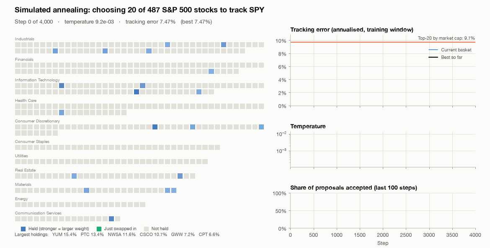
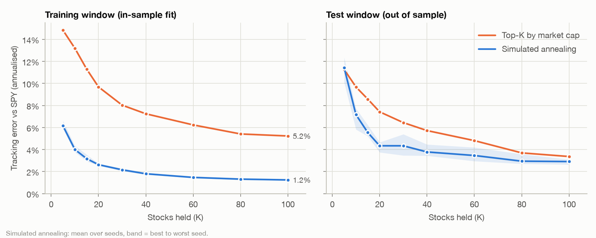
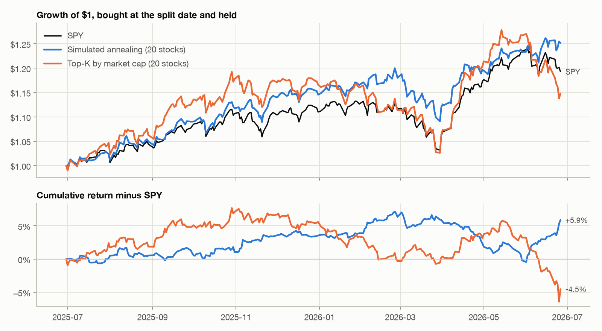

# Poor Man's ETF

**Track the S&P 500 with 20 stocks instead of 500, picking them by simulated annealing.**

[](https://github.com/ethanldfoster/poor-mans-etf/actions/workflows/ci.yml)


<picture>
  <source media="(prefers-color-scheme: dark)" srcset="assets/annealing-dark.gif">
  
</picture>

An index fund like SPY holds around 500 stocks. Copying it with a small account means
holding far fewer, but *which* 20 stocks, and in what proportions, track it most closely?

There are C(487, 20) ≈ 10³⁵ possible baskets, so they can't all be tried. This project
splits the problem in two:

- **Inner problem (exact).** For any one basket, the weights that minimise tracking error
  come from a small convex QP. It's solved exactly in about 0.3 ms.
- **Outer problem (heuristic).** Simulated annealing searches over baskets, scoring each
  one by the tracking error of its optimal weights.

## Results

Portfolios are built using **Jun 2023 to Jun 2025** only. Each is then bought on
30 Jun 2025 and **held without rebalancing for the following year**, which the optimiser
never saw.

| 20-stock portfolio | Tracking error vs SPY, training window | Tracking error vs SPY, test year |
| --- | ---: | ---: |
| Top 20 by market cap, cap-weighted | 9.7% | 7.4% |
| Simulated annealing (mean of 5 seeds) | **2.6%** | **4.3%** (seeds: 3.7–4.7%) |

*Tracking error is the annualised standard deviation of daily return differences vs SPY.*

<picture>
  <source media="(prefers-color-scheme: dark)" srcset="assets/frontier-dark.png">
  
</picture>

<picture>
  <source media="(prefers-color-scheme: dark)" srcset="assets/backtest-dark.png">
  
</picture>

What the results show:

- **Picking the biggest companies gives you a tech fund.** Almost two-thirds of the top-20
  portfolio sits in six mega-cap tech names (NVDA, MSFT, AAPL, AMZN, GOOGL, META), so it
  swings with that trade rather than with the market.
- **Annealing builds a miniature index instead.** It keeps a core of mega-caps but spreads
  the rest across sectors (utilities, energy, health care, financials, industrials) to
  match the index's overall exposures. See [the holdings](assets/holdings.png).
- **It still wins out of sample, but part of the fit is overfitting.** Its tracking error
  rises 1.5–2.5× from the training window to the test year. With only 5 stocks the
  advantage disappears completely: the fit is mostly noise. Running the annealer *longer*
  also improves the training fit but makes the test year worse (16,000 steps: 2.5% train,
  5.5% test, vs 2.65% and 4.45% at 4,000), because the optimiser starts fitting noise in
  the covariance estimate. The [walkthrough notebook](notebooks/walkthrough.ipynb) shows
  this step by step.

## How it works

### Objective

For stock returns $r$, benchmark return $r_b$ and weights $w$, the tracking variance is

$$
\mathrm{TE}^2 = \operatorname{Var}(w^\top r - r_b) = a^\top \Sigma_{\text{aug}}\, a,
\qquad a = \begin{bmatrix} w \\ -1 \end{bmatrix}
$$

where $\Sigma_{\text{aug}}$ is the covariance of daily returns of the stocks *and* the
benchmark, estimated on the training window.

### Inner problem: optimal weights for a fixed basket

$$
\min_{w} \; a^\top \Sigma_{\text{aug}}\, a \quad \text{s.t.} \quad w \ge 0, \;\; \textstyle\sum_i w_i = 1
$$

Write $\Sigma_{\text{aug}}$'s stock block as $S = U^\top U$ (Cholesky) and the stock and
benchmark covariances as $s$, with $U^\top y = s$. The objective is then
$\lVert Uw - y \rVert^2$ plus a constant, which makes this a **non-negative least-squares**
problem. The budget constraint enters as a heavily weighted extra row. SciPy's NNLS solves
it to the same optimum as SLSQP, about 40× faster
([`tracking.py`](src/poor_mans_etf/tracking.py)).

### Outer problem: simulated annealing over baskets

([`annealing.py`](src/poor_mans_etf/annealing.py))

| | |
| --- | --- |
| **State** | the set of stocks held |
| **Move** | swap one held stock for one that isn't (or add/remove one when the size is free) |
| **Score** | annualised tracking error of the basket's optimal weights, plus an optional cost per holding |
| **Acceptance** | always if better; otherwise with probability $e^{-\Delta / T}$ (the Metropolis rule) |
| **Cooling** | geometric, $T \leftarrow 0.999\,T$ per step, over 4,000 steps |
| **Start temperature** | calibrated by a short random walk so ~80% of uphill moves are accepted at first |

Scores are cached per basket because the search revisits baskets often as it cools. A run
takes about 3 seconds.

### Data and evaluation

([`data.py`](src/poor_mans_etf/data.py), [`backtest.py`](src/poor_mans_etf/backtest.py))

- Daily adjusted closes for the S&P 500 constituents and SPY, from Yahoo Finance, are cached
  in `data/` so results reproduce without network access.
- Share-class tickers are mapped to Yahoo's format (`BRK.B` → `BRK-B`), and only one class
  per company is kept, so Alphabet isn't counted twice.
- Stocks without a full price history (recent IPOs and spin-offs) are dropped rather than
  truncating everyone's history.
- The naive baseline uses market caps **on the formation date** (shares outstanding ×
  that day's close), not today's.

## Quickstart

```bash
git clone https://github.com/ethanldfoster/poor-mans-etf.git
cd poor-mans-etf
python -m venv .venv && source .venv/bin/activate
pip install -e ".[dev]"

poor-mans-etf run                    # optimise a 20-stock portfolio and compare with the naive one
```

```text
Universe:  487 S&P 500 stocks, benchmark SPY
Train:     2023-06-29 to 2025-06-30 (502 days)
Test:      2025-06-30 to 2026-06-26 (250 days)
Annealing: 4,000 steps in 2.7s, seed 0

Tracking error vs SPY (annualised)         Train    Test
Simulated annealing (K=20)                 2.71%   4.66%
Top-K by market cap (K=20)                 9.69%   7.42%

Holdings (20 stocks):
  MSFT   11.32%  Microsoft (Information Technology)
  AAPL    8.87%  Apple Inc. (Information Technology)
  DUK     7.80%  Duke Energy (Utilities)
  HD      6.50%  Home Depot (The) (Consumer Discretionary)
  XOM     6.33%  ExxonMobil (Energy)
  ...
```

Other commands:

```bash
poor-mans-etf run --k 30 --seed 1                 # a different basket size or seed
poor-mans-etf run --k auto --holding-cost 0.001   # let the size float: each stock must earn 0.1pp of TE
poor-mans-etf frontier                            # tracking error against basket size (5 seeds per K)
poor-mans-etf animate                             # render the GIF
poor-mans-etf figures                             # regenerate everything in assets/
poor-mans-etf fetch                               # re-download data from Yahoo Finance
pytest                                            # tests
```

## Project layout

```text
src/poor_mans_etf/
  data.py        constituents, Yahoo Finance download, cache, cleaning
  tracking.py    tracking-error maths and the NNLS weight optimiser
  annealing.py   simulated annealing over baskets
  backtest.py    train/test split, buy-and-hold evaluation, frontier
  plots.py       static figures (light and dark themes)
  animate.py     the GIF
  cli.py         the poor-mans-etf command
notebooks/walkthrough.ipynb   step-by-step explanation with outputs
data/                         cached prices and share counts
assets/                       figures used in this README
tests/                        pytest suite (runs offline on the cached data)
```

## Limitations

- **Survivorship bias.** The universe is today's S&P 500, so stocks that joined during the
  window are in it from the start, and companies that left the index never appear.
  This affects both portfolios.
- **Approximate historical market caps.** These use today's share counts, so buybacks and
  issuance are ignored.
- **One train/test split.** A single year is one sample. A rolling walk-forward test would
  give a distribution.
- **No costs.** Transaction costs, taxes and fractional-share constraints are ignored.

## Ideas for next steps

- Shrink the covariance estimate (Ledoit–Wolf, or a factor model) to cut the overfitting.
- Rolling backtest with periodic rebalancing and turnover costs.
- Point-in-time index constituents.
- Compare against other approaches to cardinality-constrained tracking: greedy forward
  selection, L1-regularised regression, or an exact mixed-integer QP for small universes.

## License

[Apache 2.0](LICENSE)
